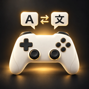
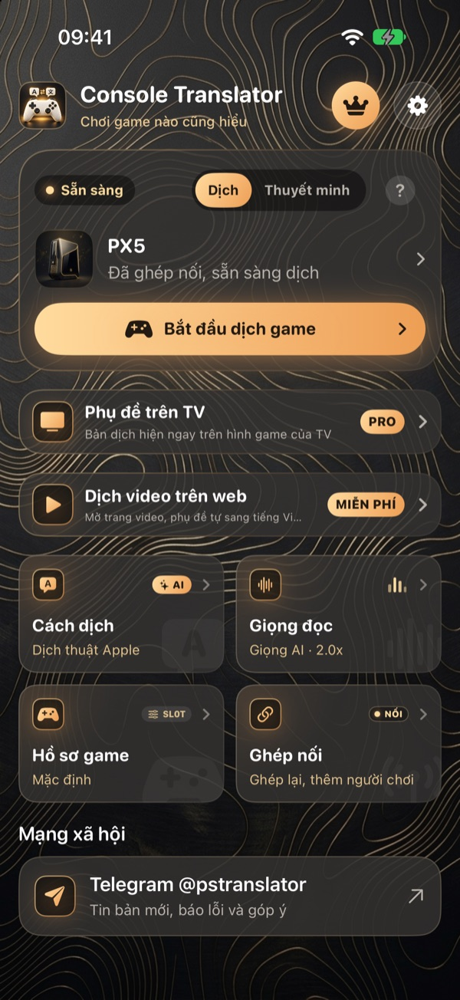
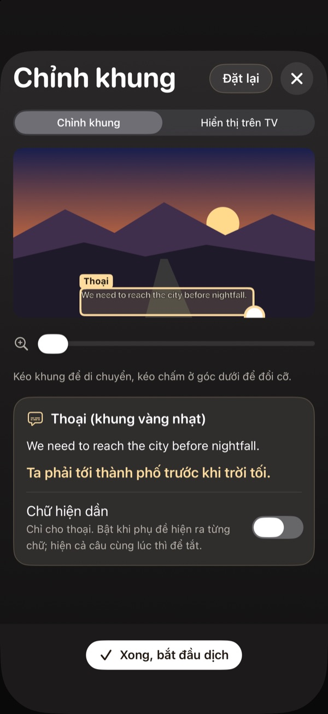
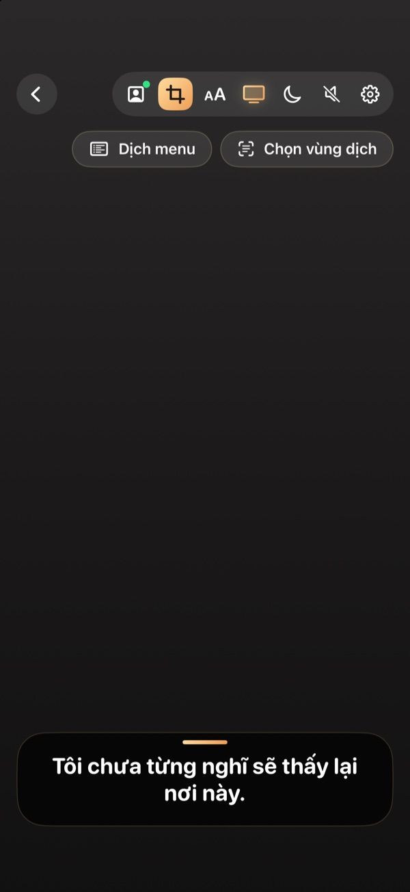
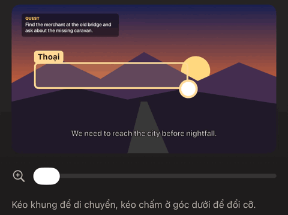
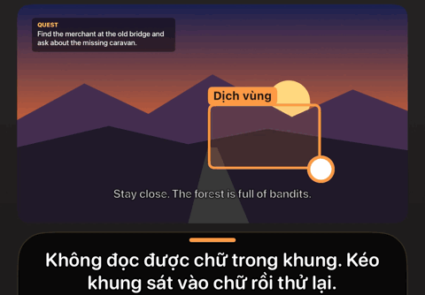
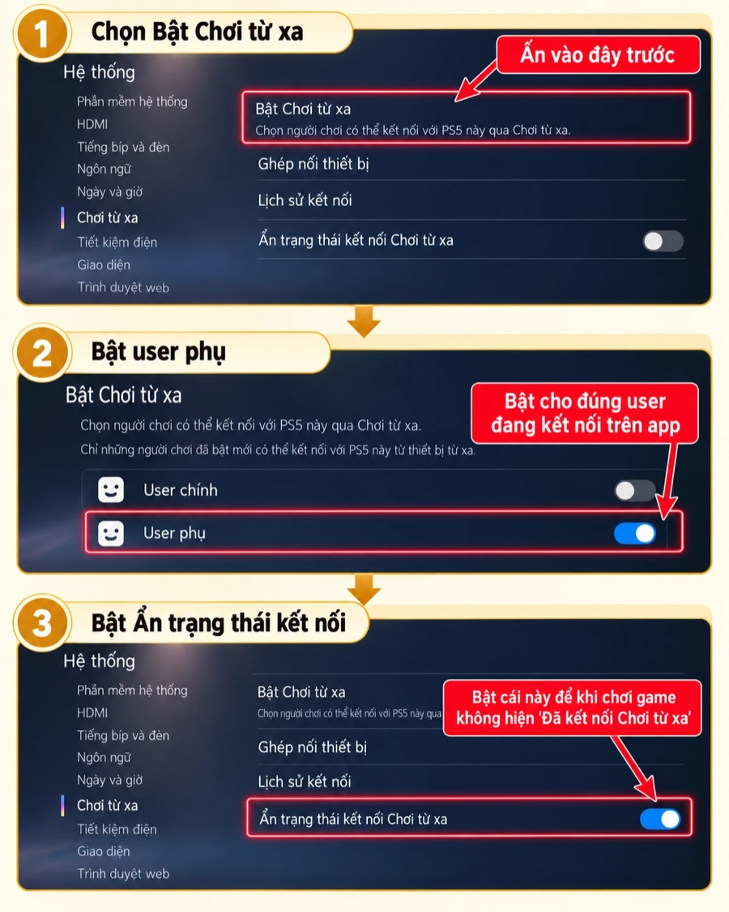
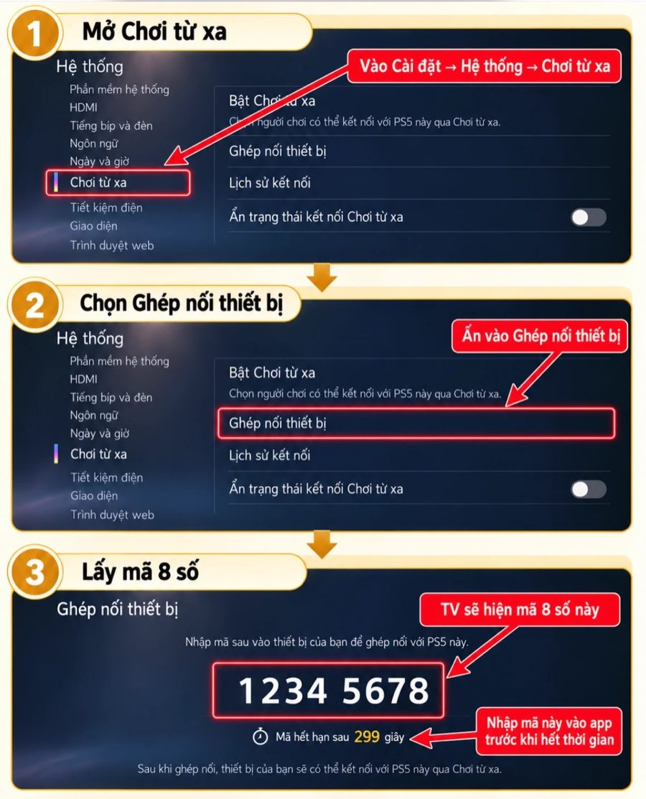
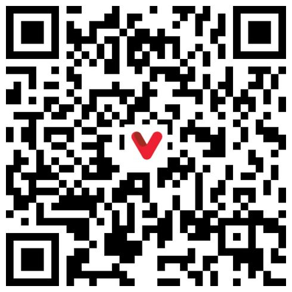

  

<h1 align="center">Console Translator: Dịch game</h1>

<b>Chơi game nào cũng hiểu</b> Dịch phụ đề game sang tiếng Việt và đọc to, ngay trên iPhone. Không cần capture card.

  <a href="https://kyozxx.github.io/PS-Translator/guide.html"><b>📖 Hướng dẫn đầy đủ</b></a> ·
  <a href="https://t.me/consoletranslatorbot"><b>📲 Nhận link cài app</b></a> ·
  <a href="https://t.me/pstranslator"><b>💬 Kênh Telegram</b></a> ·
  <a href="https://kyozxx.github.io/Console-Translator/guide.html"><b>🤖 Bản Android</b></a>

  
  
  

## Làm được gì

- **Dịch thoại tự động**: kết nối thẳng tới máy chơi game qua Wi-Fi nhà, đọc phụ đề tiếng Anh, hiện và đọc to bản dịch tiếng Việt.
- **Chọn vùng dịch**: kéo khung tới nhiệm vụ, thư, mô tả vật phẩm, bảng lựa chọn hội thoại.
- **Dịch menu**: mở menu kỹ năng, túi đồ, bản đồ là app tự dịch các đoạn mô tả.
- **Phụ đề trên TV**: bản dịch hiện ngay trên TV, đè lên hình game, giọng đọc ra loa TV. Android TV, TV LG (cài app ngay trên iPhone), TV Samsung từ 2017.
- **Chơi trên điện thoại**: xem và điều khiển máy chơi game ngay trên iPhone, kèm phụ đề dịch.
- **Dịch video trên web**: YouTube và trang video khác, miễn phí.
- **Nhiều bộ dịch và giọng đọc**: Dịch thuật Apple (miễn phí, không cần mạng), Dịch AI, Apple Intelligence, Gemini; giọng cơ bản hoặc giọng AI.

  
  

## Cài app

Cần iPhone hoặc iPad chạy **iOS 18 trở lên**.

1. Cài [TestFlight](https://apps.apple.com/app/testflight/id899247664) từ App Store.
2. Mở bot [**t.me/consoletranslatorbot**](https://t.me/consoletranslatorbot), bấm **Start** → **🍎 Bản iOS** để nhận link.
3. TestFlight mở ra, bấm **Chấp nhận** rồi **Cài đặt**.

| | Bản Free | Bản Premium |
|---|---|---|
| Dịch thoại, Chọn vùng dịch, Dịch menu | ✓ | ✓ |
| Phụ đề trên TV, giọng đọc ra loa TV | | ✓ |
| Dịch AI, 4 giọng AI | | ✓ |
| Chơi trên điện thoại | | ✓ |

Cài file IPA bằng máy tính (Sideloadly, AltStore)

1. Tải `PS-Translator.ipa` ở mục [**Releases**](../../releases/latest). Không tải file Source code.
2. Cài [Sideloadly](https://sideloadly.io) hoặc [AltStore](https://altstore.io), cắm iPhone, kéo file IPA vào và đăng nhập Apple ID.
3. Trên iPhone: **Cài đặt → Cài đặt chung → VPN & Quản lý thiết bị**, chọn Apple ID rồi bấm **Tin cậy**. Nếu được hỏi, bật **Chế độ nhà phát triển** trong Quyền riêng tư & Bảo mật.

Apple ID miễn phí: app hết hạn sau 7 ngày và phải cài lại.

## Bắt đầu nhanh

1. **Trên máy chơi game**: tạo một tài khoản phụ, bật **Chơi từ xa** cho tài khoản đó.
2. **Trong app**: tìm máy, dán mã người chơi tra từ [psntools.com/psn/checker](https://www.psntools.com/psn/checker), nhập mã 8 số hiện trên TV.
3. **Chơi**: bấm **Bắt đầu dịch game → Dịch khi chơi TV**, kéo khung Thoại tới dòng phụ đề.

Từng bước có ảnh: [**Hướng dẫn cài và ghép nối**](https://kyozxx.github.io/PS-Translator/guide.html) · [**Cách dùng từng chức năng**](https://kyozxx.github.io/PS-Translator/guide.html#dung-man-chinh) · [**Gặp lỗi**](https://kyozxx.github.io/PS-Translator/guide.html#panel-fix)

  
  

> [!TIP]
> Nên dùng **tài khoản phụ** cho app. Mỗi tài khoản chỉ dùng được ở một nơi cùng lúc: dùng chung tài khoản đang cầm tay cầm thì tay cầm bị ngắt. Đây là cách máy chơi game hoạt động, không ảnh hưởng gì tới tài khoản.

## Phụ đề trên TV

Cài app nhận phụ đề lên TV **trước khi mua**: TV hiện được mã 8 số là dùng được.

| TV | Cách cài | Hướng dẫn |
|---|---|---|
| Android TV / Google TV (Android 9+) | [Google Play](https://play.google.com/apps/testing/com.kyozx.consoletranslator.tv.play) hoặc [APK 0.2.8](https://github.com/kyozxx/PS-Translator/releases/download/tv-android-0.2.8/Console-Translator-TV.apk) | [TV.md](TV.md) |
| TV LG webOS | **Ngay trên iPhone** (cần PRO) hoặc [Windows 1.2.17](https://github.com/kyozxx/PS-Translator/releases/download/lg-pc-1.2.17/ConsoleTranslator-LG-PC-1.2.17.zip) · [Mac 1.0.5](https://github.com/kyozxx/PS-Translator/releases/download/lg-mac-1.0.5/ConsoleTranslator-LG-Mac-1.0.5.zip), máy tính cần mã `LGTV-…` | [LG.md](LG.md) |
| TV Samsung từ 2017 (Tizen 3.0+) | [Windows 1.0.15](https://github.com/kyozxx/PS-Translator/releases/download/samsung-pc-1.0.15/ConsoleTranslator-Samsung-PC-1.0.15.zip) · [Mac 1.0.9](https://github.com/kyozxx/PS-Translator/releases/download/samsung-mac-1.0.9/ConsoleTranslator-Samsung-Mac-1.0.9.zip), cần mã `SSTV-…` | [SAMSUNG.md](SAMSUNG.md) |

Mã `LGTV-…` và `SSTV-…` nhận qua bot [t.me/consoletranslatorbot](https://t.me/consoletranslatorbot). TV LG cài được ngay trên iPhone (PRO) hoặc bằng máy tính lần đầu, sau đó iPhone tự mở app trên TV. Samsung 2016 trở về trước, TV hệ điều hành khác và Android Box không dùng được.

## Hỏi đáp và báo lỗi

Xem mục [**Gặp lỗi**](https://kyozxx.github.io/PS-Translator/guide.html#panel-fix) trên trang hướng dẫn. Chưa được thì nhắn [kênh Telegram](https://t.me/pstranslator) kèm ảnh chụp màn hình (che mã người chơi, IP, mã 8 số).

## Ủng hộ

Thấy app hữu ích thì mời mình ly cà phê nhé.

**MB Bank · 008808 · TRAN VAN NITO**

  

---

Console Translator là ứng dụng độc lập, không liên kết hay được bảo trợ bởi bất kỳ hãng máy chơi game nào. Tên sản phẩm và nhãn hiệu thuộc về chủ sở hữu tương ứng. [Chính sách riêng tư](PRIVACY.md)
