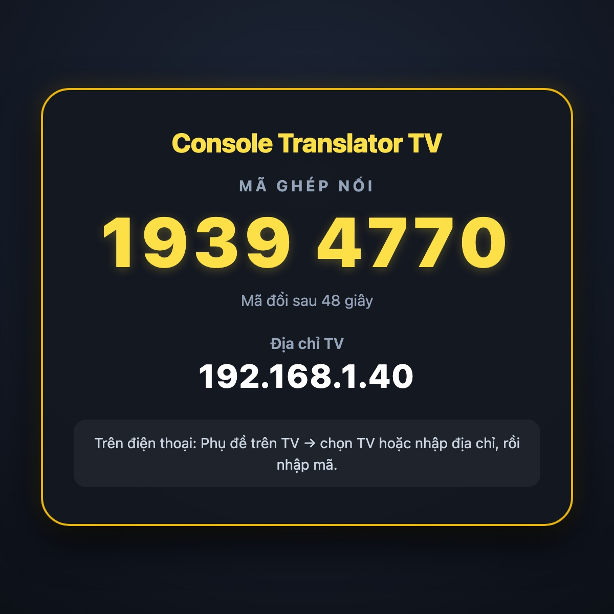
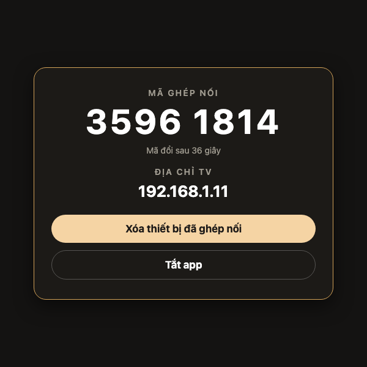
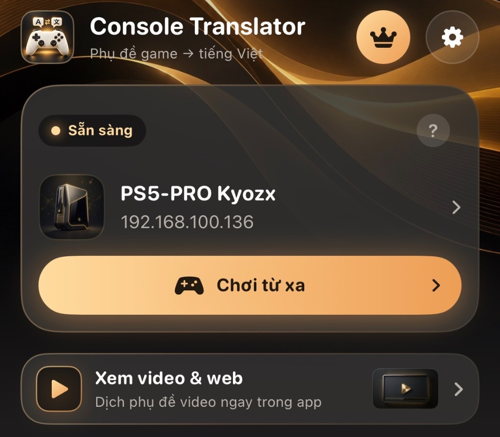
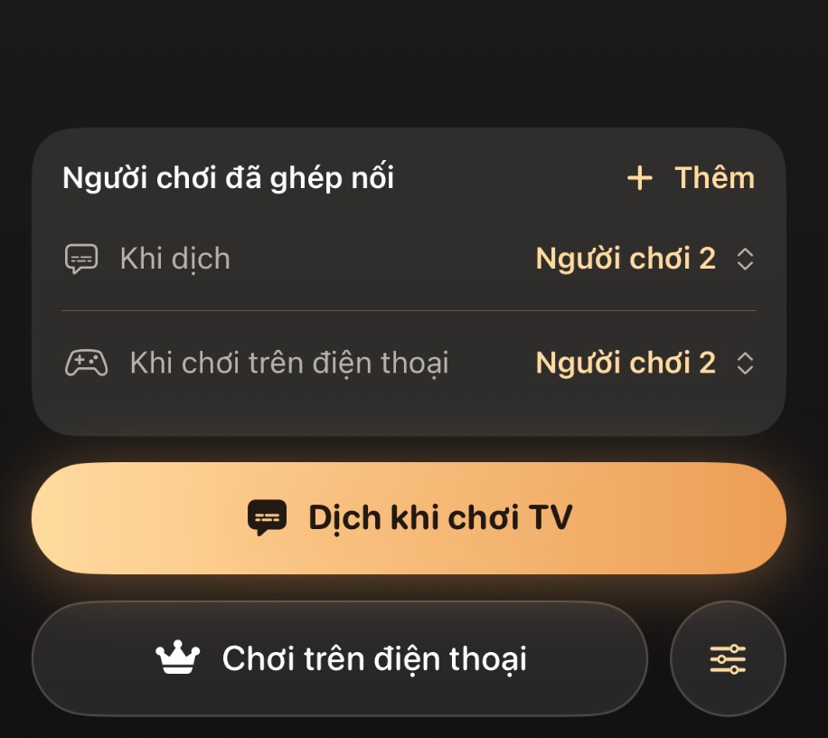
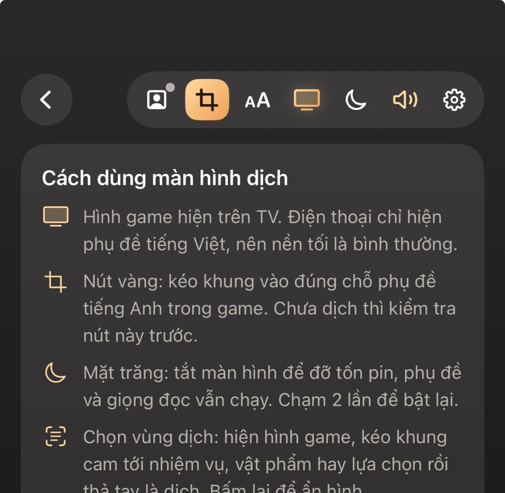
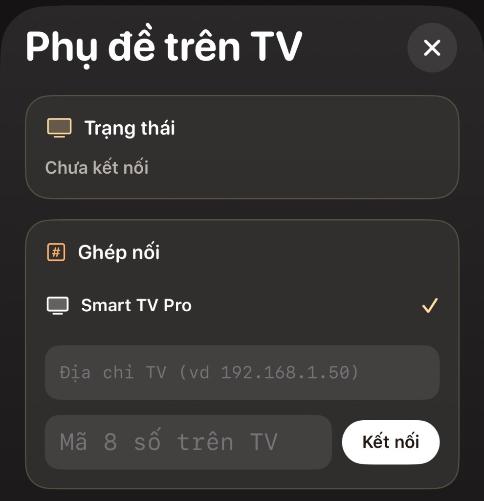

# Phụ đề trên TV – Hướng dẫn cài app TV

Phụ đề tiếng Việt hiện nổi ngay trên hình game ở TV. Máy chơi game vẫn cắm HDMI thẳng vào TV nên hình gốc, không trễ. Chỉ có chữ (và giọng đọc nếu bật) đi từ iPhone sang TV qua Wi-Fi.

> **Android TV:** tải app ngay ở phần dưới. **TV LG:** xem [hướng dẫn cài bằng Windows hoặc Mac](LG.md). **TV Samsung:** xem [hướng dẫn cài bằng Windows hoặc Mac](SAMSUNG.md). Với LG và Samsung, nhắn Telegram https://t.me/pstranslator để nhận mã cài PC.

**Mục lục**
- [Kiểm tra TV trước khi mua](#kiểm-tra-tv-trước-khi-mua)
- [Cần có](#cần-có)
- [Android TV](#android-tv)
  - [TV Xiaomi nội địa Trung Quốc](#tv-xiaomi-nội-địa-trung)
- [TV LG (webOS)](#tv-lg-webos)
- [TV Samsung (Tizen)](#tv-samsung-tizen)
- [Ghép nối với iPhone](#ghép-nối-với-iphone)
- [Lỗi thường gặp](#lỗi-thường-gặp)

## Kiểm tra TV trước khi mua

Tính năng Phụ đề trên TV không chạy trên mọi TV. Hãy kiểm tra trước khi mua gói PRO hoặc donate, vì khoản đã mua không đổi lại được chỉ vì TV không tương thích.

| TV của bạn | Dùng được không |
| --- | --- |
| Android TV / Google TV, Android 9 trở lên | **Được.** Riêng TV nào khóa quyền "Hiển thị trên ứng dụng khác" thì không hiện được phụ đề. |
| Android TV 8 trở xuống (thường là TV đời 2018 về trước) | **Không cài được.** |
| TV LG webOS | **Thử nghiệm.** Cần bật Developer Mode và cài bằng máy tính hoặc điện thoại Android. Đã chạy trên webOS 7 (TV 2022), các đời khác chưa kiểm tra hết. |
| TV Samsung từ 2017 (Tizen 3.0 trở lên) | **Thử nghiệm.** Cần bật Developer Mode, máy tính Windows hoặc Mac để cài, và một tài khoản Samsung. Một số TV đời 2018 đang gặp lỗi khi cài, chưa xử lý xong. |
| TV Samsung 2016 trở về trước (Tizen 2.x) | **Không dùng được.** |
| TV hệ điều hành khác, Android Box | **Không hỗ trợ.** |

**Cách chắc nhất, không mất tiền:** cài app nhận phụ đề lên TV trước. Khi TV hiện được mã ghép nối 8 số (và với Samsung là hiện được hình cổng HDMI) thì TV đó dùng được, lúc đó hãy mua.

Xem đời TV Samsung: trên TV vào **Cài đặt → Hỗ trợ → Giới thiệu về TV**, xem mã model. Chữ cái sau số inch thường cho biết năm: K = 2016, M = 2017, N = 2018, R = 2019, T = 2020, A = 2021, B = 2022, C = 2023, D = 2024. Chắc chắn hơn: bấm **Kiểm tra kết nối TV** trong bộ cài, nhật ký hiện dòng "TV: Tizen ..."; Tizen 2.x là TV 2016 trở về trước.

## Cần có

- Một TV nằm trong bảng tương thích ở trên.
- TV và iPhone dùng chung một mạng Wi-Fi.
- App Console Translator trên iPhone có gói PRO.
- Trên iPhone, chọn đúng loại TV trong màn **Phụ đề trên TV → Loại TV**.

---

## Android TV

### Bước 1: Cài app

> **TV Xiaomi / Redmi mua từ Trung Quốc (hàng nội địa, giao diện tiếng Trung PatchWall)?** Dùng bản riêng ở mục [TV Xiaomi nội địa](#tv-xiaomi-nội-địa-trung). Bản thường bị TV này tự tắt.

Tải file **Console-Translator-TV.apk** (phiên bản 0.2.8):

```
https://github.com/kyozxx/PS-Translator/releases/download/tv-android-0.2.8/Console-Translator-TV.apk
```

Cách cài dễ nhất bằng remote TV:

1. Trên TV, mở Google Play, tìm và cài app **Downloader by AFTVnews**.
2. Vào **Cài đặt TV → Ứng dụng → Quyền truy cập ứng dụng đặc biệt → Cài đặt ứng dụng không rõ nguồn**, bật cho **Downloader**.
3. Mở Downloader, gõ đường link tải ở trên rồi bấm **Go**.
4. Tải xong, bấm **Cài đặt**. Đã cài bản cũ thì cứ cài đè, không cần ghép nối lại.

Hoặc nhập mã Downloader **5580719**.

Từ bản 0.2.3, khi có bản mới app TV tự hiện nút **Cập nhật** ngay trên màn hình ghép nối: bấm vào là app tự tải và cài, không cần Downloader nữa.

### Bước 2: Cấp quyền hiển thị phụ đề

1. Mở app **Console Translator TV**, bấm **Cấp quyền hiển thị trên ứng dụng khác**.
2. Trong trang cài đặt vừa mở, chọn **Console Translator TV** và bật **Cho phép hiển thị trên ứng dụng khác**. Nếu TV hiện danh sách ứng dụng, bạn cần chọn app trước.
3. Bấm **Back** quay lại app. Khi đã cấp quyền, app hiện **Đã cấp quyền, sẵn sàng nhận phụ đề từ iPhone**.
4. Nếu app hỏi **bỏ qua tối ưu hóa pin**, chọn **Cho phép** để TV không tắt app khi chuyển sang cổng HDMI.

**Bấm nút nhưng không chuyển qua cài đặt, hoặc không thấy chỗ bật quyền?** Một số Android TV/Google TV không hỗ trợ mở thẳng trang quyền. Từ bản 0.2.1, app thử thêm các trang cài đặt dự phòng và có nút **Hướng dẫn cấp quyền thủ công** ngay trong app.

Dùng remote TV làm lần lượt:

1. Bấm **Home**, mở **Cài đặt TV** (biểu tượng bánh răng).
2. Vào **Ứng dụng → Quyền truy cập ứng dụng đặc biệt (Special app access) → Hiển thị trên ứng dụng khác (Display over other apps)**.
3. Chọn **Console Translator TV**, bật **Cho phép** rồi mở lại app.

Tên và vị trí menu có thể khác theo hãng: tìm **Quyền đặc biệt**, **Quyền truy cập đặc biệt**, **Xuất hiện trên cùng** hoặc xem trong **Cài đặt → Tùy chọn thiết bị → Ứng dụng**. Trang **Thông tin ứng dụng** và quyền **Cài đặt ứng dụng không rõ nguồn** không thay thế quyền hiển thị phụ đề.

#### TV không có menu hiển thị trên ứng dụng khác

Nếu TV cho phép ADB, có thể cấp quyền bằng máy tính cùng mạng:

1. Cài [Android SDK Platform Tools](https://developer.android.com/tools/releases/platform-tools) trên máy tính.
2. Trên TV, bật **Tùy chọn nhà phát triển** (thường bấm 7 lần vào **Số bản dựng/Build** trong **Giới thiệu**), rồi bật **Gỡ lỗi USB**, **Gỡ lỗi mạng** hoặc **Gỡ lỗi không dây**, tùy TV.
3. Kết nối ADB theo cách TV hỗ trợ. Nếu TV có **Gỡ lỗi không dây**, dùng `adb pair <IP-TV>:<cổng-ghép-nối>` với mã TV hiển thị, sau đó `adb connect <IP-TV>:<cổng-kết-nối>`. Hai cổng có thể khác nhau. TV dùng gỡ lỗi mạng kiểu cũ thường dùng `adb connect <IP-TV>:5555`. Chấp nhận yêu cầu kết nối từ máy tính của bạn trên TV.
4. Kiểm tra `adb devices` thấy TV ở trạng thái `device`, rồi chạy:

```sh
adb shell appops set com.kyozx.consoletranslator.tv SYSTEM_ALERT_WINDOW allow
```

5. Mở lại app TV để kiểm tra quyền. Tắt gỡ lỗi sau khi hoàn tất. Nếu kết nối nhiều thiết bị, thêm `-s <địa-chỉ-thiết-bị>` sau `adb` để chọn đúng TV.

Một số firmware khóa quyền này hoàn toàn, app không thể tự cấp hoặc bảo đảm hiển thị trên HDMI. Nếu vẫn không được, gửi hãng/model TV, phiên bản Android và ảnh màn cài đặt vào [Telegram hỗ trợ](https://t.me/pstranslator).

### Bước 3: Mở app

Mở app Console Translator TV. Màn hình hiện **mã 8 số** và **địa chỉ TV**. Làm tiếp phần [Ghép nối với iPhone](#ghép-nối-với-iphone).

Muốn tắt app: bấm **Tắt app** trong app TV.

### TV Xiaomi nội địa Trung

TV Xiaomi và Redmi bán ở Trung Quốc tự tắt app phụ đề bản thường: mở app lên là app bị đóng, hoặc phụ đề không bao giờ hiện. Dùng bản riêng dưới đây. TV Xiaomi bản quốc tế (Google TV, giao diện tiếng Anh/tiếng Việt) dùng bản thường ở trên.

Tải file **Console-Translator-TV-Mi.apk** (phiên bản 0.2.8-mi):

```
https://github.com/kyozxx/PS-Translator/releases/download/tv-android-0.2.8-mi/Console-Translator-TV-Mi.apk
```

1. Cài như [Bước 1](#bước-1-cài-app), chỉ thay đường link bằng link ở trên (hoặc mã Downloader **1698710**). Nếu TV không có Google Play, cài **Downloader** hoặc **当贝市场 (Dangbei)** từ kho ứng dụng của Xiaomi, hoặc chép file APK qua USB rồi mở bằng trình quản lý tệp.
2. App có tên **Console Translator TV (Mi)**, cài được song song với bản thường. Đã lỡ cài bản thường thì nên gỡ đi cho đỡ nhầm.
3. Cấp quyền hiển thị như [Bước 2](#bước-2-cấp-quyền-hiển-thị-phụ-đề). Trên TV Xiaomi, quyền này thường nằm ở **设置 (Cài đặt) → 应用 (Ứng dụng) → 权限 / 特殊权限 → 显示在其他应用上层 (Hiển thị trên ứng dụng khác)**.
4. Mở app, ghép nối với iPhone như bình thường.

**Không bật được quyền hiển thị trên ứng dụng khác?**

1. TV: **Settings → Accounts and Security → ADB** → bật, chọn **ALLOW**.
2. Mở app **Permissions Manager** (khiên xanh).
3. Chọn **Console Translator TV (Mi)** → `android.permission.SYSTEM_ALERT_WINDOW` → **Allow**.

Khác với bản thường: lúc đang mở màn hình app thì **chưa có phụ đề**. Phụ đề chỉ hiện sau khi bấm **Home** hoặc chuyển sang cổng HDMI của máy chơi game. Đây là cách để TV Xiaomi không tự tắt app.

Cấp quyền bằng máy tính (ADB) thì dùng tên gói của bản Mi:

```sh
adb shell appops set com.kyozx.consoletranslator.tv.mi SYSTEM_ALERT_WINDOW allow
```

### Giọng đọc trên loa TV

Từ bản 0.2.0, giọng đọc tiếng Việt có thể phát ra loa TV cùng tiếng game, điện thoại im lặng.

1. Trên iPhone, mở **Phụ đề trên TV → Giọng đọc trên TV**, bật **Phát giọng đọc ra loa TV** và chỉnh âm lượng.
2. Hoặc bấm **nút loa** trên thanh công cụ màn Dịch khi chơi TV, chọn **Đọc trên loa TV** (chỉ chọn được khi đang kết nối TV).
3. Không nghe thấy khi đang chơi: vào cài đặt âm thanh của TV, đổi **âm thanh số (Digital Audio Out)** sang **PCM**.

### Dịch vùng trên TV

Bản dịch của **Chọn vùng dịch** (nhiệm vụ, mô tả vật phẩm, bảng lựa chọn) hiện trên TV trong một hộp riêng, tách khỏi phụ đề thoại. Cần app TV 0.2.3 trở lên (TV LG: app 1.2.0, TV Samsung: app 1.1.0, cài bằng bộ cài mới nhất).

**Dịch menu**: trên màn dịch của iPhone, bấm **Dịch menu** khi đang mở menu, kỹ năng, túi đồ hay hướng dẫn. Bản dịch từng đoạn hiện ngay tại chữ gốc trên TV: đặt bên cạnh không che chữ, hoặc đè lên chữ gốc, cỡ chữ chỉnh được. Bật **Tự động** (giữ nút) để app tự dịch khi màn hình đứng yên. Cần app TV 0.2.4 trở lên (TV LG: app 1.2.3, TV Samsung: app 1.1.4); app TV cũ vẫn chạy phụ đề bình thường, chỉ chưa hiện Dịch menu.

1. Trên iPhone, ở màn hình dịch bấm **Chọn vùng dịch**, kéo khung cam tới chỗ cần dịch rồi thả tay. Bản dịch hiện trên điện thoại và trên TV.
2. Chọn chỗ hiện trên TV: bấm nút **khung cắt** (nút vàng) → **Hiển thị trên TV**. Kéo khung **Thoại** và khung **Dịch vùng** ngay trên hình game, kéo chấm tròn để đổi độ rộng. TV đổi theo khi bạn thả tay.
3. Chạm vào khung nào thì chỉnh cỡ chữ, màu chữ và nền của khung đó. Khung Dịch vùng có thêm **Tự ẩn sau** (mặc định 10 giây).
4. Bật **Đè lên chữ gốc trong game** nếu muốn bản dịch nằm đúng chỗ chữ tiếng Anh: chữ dịch bắt đầu đúng chỗ chữ gốc bắt đầu.
5. Bấm **Hiển thị thử** để xem cả hai khung trên TV mà không cần vào game. Nút loa bên cạnh phát thử giọng đọc ra loa TV.

---

## TV LG (webOS)

Cài bằng [bộ cài Windows 1.2.17](https://github.com/kyozxx/PS-Translator/releases/download/lg-pc-1.2.17/ConsoleTranslator-LG-PC-1.2.17.zip) hoặc [bộ cài Mac 1.0.5](https://github.com/kyozxx/PS-Translator/releases/download/lg-mac-1.0.5/ConsoleTranslator-LG-Mac-1.0.5.zip), nhập đầy đủ mã `LGTV-…` được cấp riêng, không cần dùng Terminal. Xem [hướng dẫn cài TV LG từ PC](LG.md), gồm bật Developer Mode, tải bộ cài và mở app mỗi lần chơi.

---

## TV Samsung (Tizen)

Cài bằng [bộ cài Windows 1.0.15](https://github.com/kyozxx/PS-Translator/releases/download/samsung-pc-1.0.15/ConsoleTranslator-Samsung-PC-1.0.15.zip) hoặc [bộ cài Mac 1.0.9](https://github.com/kyozxx/PS-Translator/releases/download/samsung-mac-1.0.9/ConsoleTranslator-Samsung-Mac-1.0.9.zip), nhập đầy đủ mã `SSTV-…` được cấp riêng và đăng nhập tài khoản Samsung của bạn khi được hỏi. Xem [hướng dẫn cài TV Samsung từng bước](SAMSUNG.md).

Trên Samsung, app tự hiện hình cổng HDMI bên trong nó: mở **Console Translator TV** trên TV để chơi, bấm Home sẽ thoát cả hình lẫn phụ đề.

---

## Ghép nối với iPhone

Làm lần lượt theo các bước sau:

### Bước 1: Mở máy PS5 và mở app trên TV
Sau khi đã hoàn tất cài đặt app lên TV theo hướng dẫn ở trên, bạn bật máy PS5 trên TV rồi mở app nhận phụ đề theo từng dòng TV:
- **TV Samsung:** Bấm trực tiếp vào app **Console Translator TV** trên màn hình TV để mở.
- **TV LG (webOS):**
  - Dùng **iPhone**: Mở app qua máy tính (PC/Mac) bằng cách bấm **Mở app trên TV**.
  - Dùng **Android**: Bấm mở app ngay trong app Android (Cài đặt → Phụ đề trên TV).
- **Android TV / Google TV:** Mở trực tiếp app **Console Translator TV** trên màn hình TV.

Khi app mở lên, màn hình TV sẽ hiển thị **Địa chỉ TV** và **Mã ghép nối (8 số)**:

| Màn hình trên TV LG | Màn hình trên Android TV |
| :---: | :---: |
|  |  |

*(Lưu ý: Mã 8 số đổi mỗi 60 giây để bảo mật, bạn chỉ cần ghép nối 1 lần đầu, các lần sau điện thoại sẽ tự động kết nối lại).*

---

### Bước 2: Bấm Chơi từ xa và chọn Dịch khi chơi TV
Trên iPhone, mở app **Console Translator**:
1. Ở màn hình chính, bấm vào nút **Chơi từ xa**:



2. Chọn **Dịch khi chơi TV**:



---

### Bước 3: Bấm nút TV trên thanh công cụ
Tại màn hình dịch, bấm vào biểu tượng **TV** 📺 trên thanh công cụ trên cùng:



---

### Bước 4: Nhập IP và mã 8 số để kết nối
Ở bảng **Phụ đề trên TV** hiện ra:
1. Nhập **Địa chỉ TV** (ví dụ: `192.168.1.40` hoặc `192.168.1.11` như đang hiện trên màn hình TV).
2. Nhập **Mã 8 số trên TV** rồi bấm **Kết nối**:



3. Sau khi báo đã kết nối thành công, bạn chỉ cần chuyển TV sang cổng HDMI của máy chơi game (PS5 / PS4 / Xbox) là phụ đề tiếng Việt sẽ tự động nổi lên trên hình game!

Chỉnh cỡ chữ, màu chữ, nền, vị trí, độ rộng dòng và giọng đọc ngay trên iPhone. Có nút **Gửi câu thử** để kiểm tra vị trí phụ đề mà không cần vào game.

## Lỗi thường gặp

| Lỗi | Cách xử lý |
|---|---|
| Android TV: "Đã xảy ra sự cố khi phân tích cú pháp gói" | File tải chưa xong hoặc bị hỏng. Tải lại bằng Downloader, đừng gửi file qua tin nhắn. |
| LG: `LG-INSTALL` khi cài | Dùng bộ cài PC 1.2.17, kiểm tra Developer Mode còn hạn và thử cài lại. Nếu vẫn lỗi, gửi toàn bộ log cho hỗ trợ trước khi gỡ app; không cần gỡ app trước khi được hỗ trợ. |
| PC không nhận mã LGTV mới | Cập nhật bộ cài PC lên 1.2.17 rồi dán đầy đủ mã. Mã ANDROID không dùng trong bộ cài PC. |
| LG: không cài được, báo lỗi kết nối | Kiểm tra Developer Mode còn hạn, Key Server đang bật, IP đúng, máy tính cùng Wi-Fi với TV. |
| iPhone không tìm thấy TV | Mở app TV trên TV, kiểm tra cùng Wi-Fi, hoặc nhập địa chỉ IP đang hiện trên TV. Kiểm tra iPhone đã cho phép **Mạng cục bộ** trong Cài đặt → Quyền riêng tư. |
| Sai mã | Mã đổi mỗi phút, nhập mã đang hiện trên TV. |
| Android TV: bấm cấp quyền nhưng không mở cài đặt | Cài bản 0.2.1 trở lên, bấm **Hướng dẫn cấp quyền thủ công** trong app hoặc làm theo Bước 2 ở trên. |
| Android TV: phụ đề không hiện trên hình game | Kiểm tra đã cấp quyền hiển thị trên ứng dụng khác. Một số TV mất quyền này sau khi khởi động lại, cấp lại là được. |
| Android TV: không nghe giọng đọc khi đang ở cổng HDMI | Đổi âm thanh số của TV sang **PCM**. Kiểm tra âm lượng trong **Giọng đọc trên TV** trên iPhone. |
| TV Xiaomi nội địa: mở app thì app tự tắt, hoặc phụ đề không hiện | Dùng bản riêng [TV Xiaomi nội địa](#tv-xiaomi-nội-địa-trung). Phụ đề chỉ hiện sau khi chuyển sang cổng HDMI. |
| Phụ đề biến mất sau một lúc | Android TV: cho phép app bỏ qua tối ưu hóa pin. TV LG: mở lại app (thường do đã bấm Home trên remote). |
| Muốn xóa iPhone đã ghép | Android TV: bấm **Xóa iPhone đã ghép nối** trong app TV. iPhone: bấm **Ngắt** trong màn Phụ đề trên TV. |

Hỗ trợ: Telegram https://t.me/pstranslator
